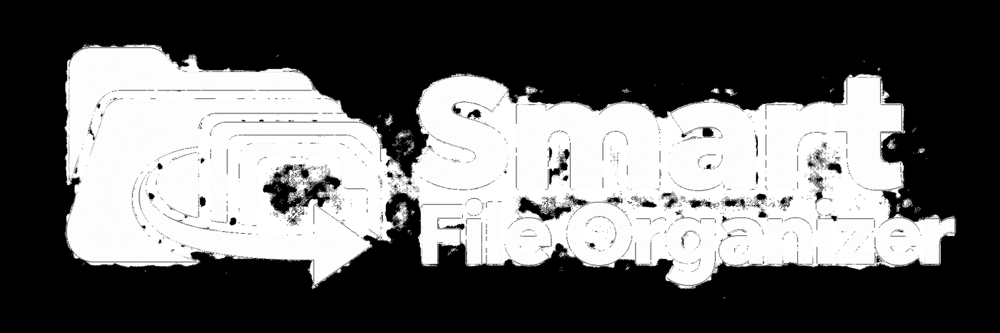

<div align="center">



<br>

**Sort your files - with a preview, a safety net, and an undo button.**

Smart File Organizer is a Windows desktop app that organizes messy folders
with a preview, guarded moves, and a local history. Automation without preview is opt-in.
Undo is available for recorded moves when the files and their original locations still pass safety checks.

<br>

[](https://github.com/TheronRadley/smart-file-organizer/actions/workflows/tests.yml)
[](https://github.com/TheronRadley/smart-file-organizer/actions/workflows/build-windows.yml)
[](https://www.python.org/)
[](#requirements)
[](CHANGELOG.md)
[](LICENSE)

<br>

[User Guide](docs/USER_GUIDE.md) · [Safety Guarantees](docs/SAFETY.md) · [Architecture](docs/ARCHITECTURE.md) · [Changelog](CHANGELOG.md) · [Contributing](CONTRIBUTING.md)

</div>

---

## Why Smart File Organizer?

Most organizers move first and explain later. This one is built the other way around:

- **Preview before manual moves.** Scan a folder, inspect the exact plan, run a dry run, then apply only the moves you selected.
- **No-clobber moves.** Previews show how collisions will be handled. Approved moves use the platform’s non-replacing rename and are refused if the destination is no longer free - see [Safety](docs/SAFETY.md) for the exact guarantees and their limits.
- **Guarded undo and recovery.** History can reverse recorded moves whose files and original locations still pass validation. Interrupted operations are surfaced for recovery; see [Safety](docs/SAFETY.md) for when Undo is unavailable.
- **Private by design.** Everything runs on your machine. No accounts, no network requests, no telemetry.

## Features

| | |
|---|---|
| **Organize** | Sort by type (10 categories + Other), extension, or modified month - with per-file selection and collision handling |
| **Duplicate Finder** | Groups identical files by size and SHA-256, reports recoverable space, and never deletes anything |
| **Large Files** | Surfaces the biggest files above a threshold, with honest incomplete-result warnings |
| **Automation** | Optional folder monitoring - preview-first by default, waits for files to appear stable, supports cooperative stop |
| **History & Recovery** | Local move journal, guarded undo, and guidance for interrupted work |
| **Reports** | Export history, scans, and duplicate reports to spreadsheet-safe CSV or JSON |

## Safety at a glance

- Detected symbolic links and Windows junctions are skipped; the app’s own data folder is excluded
- Source type, identity (when available), size and modification time are rechecked before each move
- Exports refuse to silently overwrite an existing report
- Stop cancels watcher work without waiting on the window thread; a file operation already in progress may finish

The full guarantees, limits, and threat model live in **[docs/SAFETY.md](docs/SAFETY.md)**.

## Quick start

**Requirements:** Windows 10 or 11 · Python 3.12+ (from source) · no administrator rights

```powershell
git clone https://github.com/TheronRadley/smart-file-organizer.git
cd smart-file-organizer
py -3.12 -m venv .venv
.\.venv\Scripts\Activate.ps1
python -m pip install -r requirements.txt
python app.py
```

On macOS and Linux, use `python3.12 -m venv .venv && source .venv/bin/activate`, then install and
run the same way. A desktop session and Tcl/Tk for your Python are required: run `python -m tkinter`
in the environment and check that a small window opens. If Tk is missing, install the Tk package
for your Python (for example `python3-tk` on Debian/Ubuntu for the distro Python, or
`brew install python-tk@3.12` for Homebrew Python 3.12). `pip install .` also provides the
`smart-file-organizer` command; use the pinned requirements when reproducing CI.

## Building the Windows executable

```powershell
python -m pip install -r requirements-dev.txt
python scripts/build_windows.py
python scripts/smoke_windows.py
```

Output: `dist\SmartFileOrganizer\SmartFileOrganizer.exe`. The **Windows build** workflow uses
these same scripts, launching the packaged executable in a temporary profile and checking a
preview → apply → undo round trip before uploading the artifact.

## Development

```powershell
python -m pip install -r requirements-dev.txt
python -m pytest            # tests use temporary folders only - never your real files
ruff check .
ruff format --check .
```

CI also runs a Windows source GUI smoke test, the packaged round trip, and a `pip-audit` dependency audit. Manual checks that need a real Windows desktop are listed in [docs/WINDOWS_SAFETY_CHECKLIST.md](docs/WINDOWS_SAFETY_CHECKLIST.md).

## Where your data lives

| Item | Location |
|---|---|
| Settings | `%APPDATA%\SmartFileOrganizer\settings.json` |
| History | `%APPDATA%\SmartFileOrganizer\history.sqlite3` |
| Log | `%APPDATA%\SmartFileOrganizer\app.log` |

Set `SFO_DATA_DIR` to use a different folder. The app excludes that folder from organization and allows only one running instance per data directory.

## Status

Early development (`0.1.0.dev0`) - no installer, code signing, or published release yet. The core logic is covered by an automated test suite on Windows, Linux, and macOS runners; the interface is smoke-tested in CI but has not yet had a full visual review, and the manual Windows safety checklist is still to be run. Honest, specific status - no surprises, just like the app.

## License

**Free to use, study, modify, and fork - never to sell, and never to pass off as your own.**

Smart File Organizer is source-available under the [Smart File Organizer License](LICENSE). Anyone may use, copy, modify, and redistribute it free of charge with attribution. Selling it (or any fork of it), claiming authorship, impersonating the author, or using the name and logo to imply official status is prohibited.

---

<div align="center">
<sub>Built with Python & CustomTkinter · Runs 100% locally · Your files stay yours</sub>
</div>
